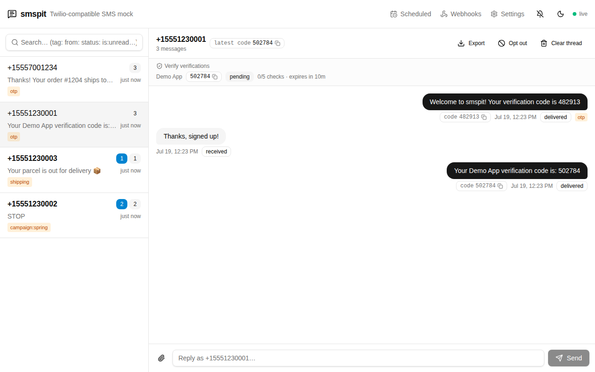
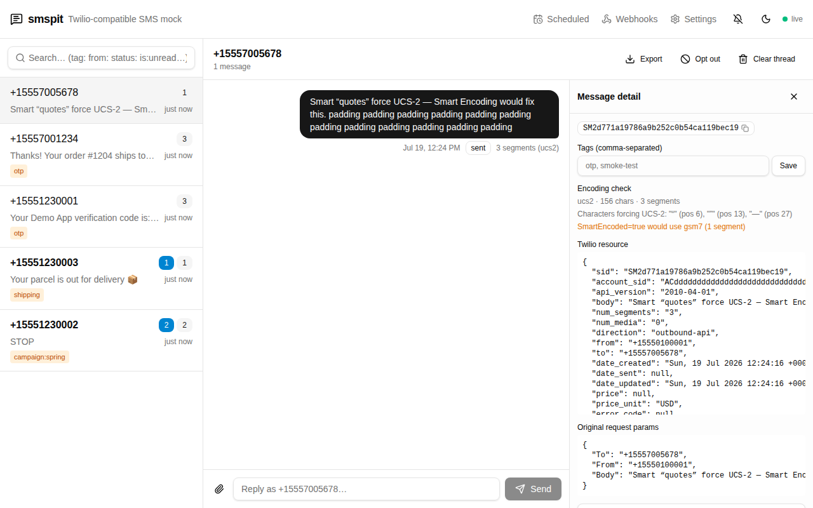
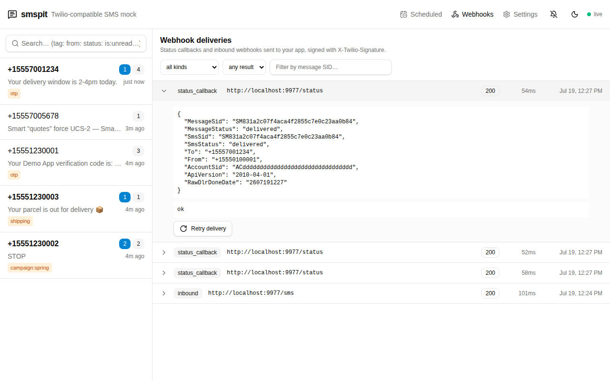
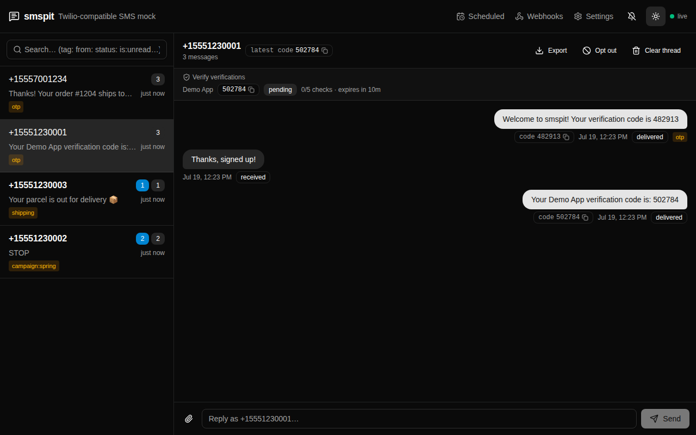
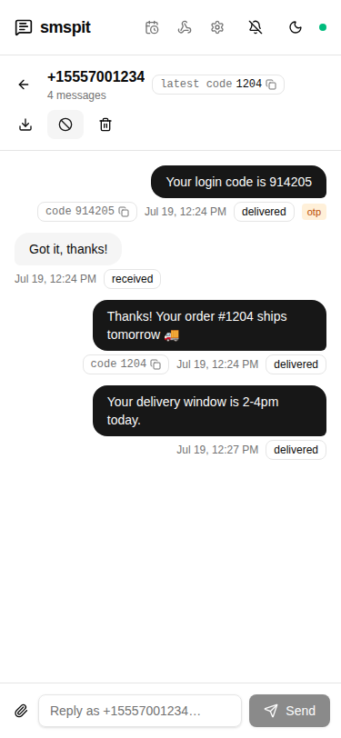

# smspit

**Mailpit, but for SMS.** A Twilio-emulating SMS testing tool for development and UAT.

Point your app's Twilio base URL at smspit and every message it sends is captured and shown in
a live dashboard instead of going anywhere near a phone. You can reply from the dashboard (your
app receives it as a signed, Twilio-format webhook, TwiML auto-replies included), and your E2E
tests can fetch the latest OTP code for any number with one GET. In production you switch back
to real Twilio by changing a single environment variable.


It emulates Programmable Messaging (2010-04-01), Messaging Services (v1), Verify (v2), and
Lookup (v2) faithfully enough that the official `twilio-python` and `twilio-node` SDKs work
unchanged — CI runs both against every build. Webhooks carry a real `X-Twilio-Signature`, so
Twilio's `RequestValidator` middleware passes too. The details (and the API quirks smspit
reproduces on purpose) are in [docs/twilio-compatibility.md](docs/twilio-compatibility.md).

| | |
|---|---|
|  **Inbox** — live threads, tags, unread counts, search operators |  **Detail drawer** — full Twilio-shaped JSON, tags, encoding check |
|  **Webhook log** — every signed delivery with payload, response, and retry |  **Dark mode** |

## Quickstart

```sh
docker run -p 8025:8025 -v ./data:/data ghcr.io/octdanb/octavenz-smspit:latest
```

Dashboard and API are both on <http://localhost:8025>. If you've cloned the repo, `just up`
does the same via compose.

## Pointing your app at smspit

Everything is served on one port, routed by path (`/2010-04-01`, `/v1`, `/v2`), so raw-HTTP
integrations need a single base URL:

```sh
TWILIO_API_BASE_URL=http://localhost:8025   # dev
# unset in production → https://api.twilio.com
```

Official SDKs pin per-product hosts; override each sub-client you use:

```python
# Python (twilio-python)
import os
from twilio.rest import Client

client = Client(account_sid, auth_token)
if base := os.environ.get("TWILIO_API_BASE_URL"):
    client.api.base_url = base       # Programmable Messaging
    client.messaging.base_url = base # Messaging Services
    client.verify.base_url = base    # Verify
    client.lookups.base_url = base   # Lookup

client.messages.create(to="+64211234567", from_="+6421000000", body="Your code is 123456")
```

```ts
// Node (twilio)
import twilio from "twilio";

const client = twilio(accountSid, authToken);
const base = process.env.TWILIO_API_BASE_URL;
if (base) {
  for (const product of ["api", "messaging", "verify", "lookups"] as const) {
    (client[product] as any).baseUrl = base;
  }
}

await client.messages.create({ to: "+64211234567", from: "+6421000000", body: "Your code is 123456" });
```

Any HTTP client works too — the API is form-encoded exactly like Twilio's:

```sh
curl -u $TWILIO_ACCOUNT_SID:$TWILIO_AUTH_TOKEN \
  --data-urlencode "To=+64211234567" \
  --data-urlencode "From=+6421000000" \
  --data-urlencode "Body=Hello from smspit" \
  http://localhost:8025/2010-04-01/Accounts/$TWILIO_ACCOUNT_SID/Messages.json
```

To receive replies, set your app's webhook URL on the Settings page (or
`PUT /api/settings {"inbound_webhook_url": "http://localhost:3000/sms"}`). Replies typed in
the dashboard arrive at your app as signed Twilio-format webhooks, and a TwiML
`<Response><Message>` answer is rendered back into the conversation.

## Testing OTP flows

`GET /api/numbers/{number}/latest-code` returns the most recent code sent to a number — it
works for plain SMS OTPs and Verify v2 alike:

```python
def test_signup_otp(page):  # your app drives the SMS send
    page.goto("http://localhost:3000/signup")
    page.fill("#phone", "+64211234567")
    page.click("#send-code")

    code = httpx.get(
        "http://localhost:8025/api/numbers/+64211234567/latest-code"
    ).json()["code"]
    page.fill("#otp", code)
    page.click("#verify")
```

The rest of the internal API is just as scriptable — simulate inbound replies, seed fixtures,
force deterministic delivery failures, add webhook latency and drops, clear state between
tests. See [docs/api.md](docs/api.md).

## The dashboard

Threads are organized per phone number with live updates, unread counts, and Mailpit-style
tags (manual, auto-tag rules, or Twilio's `Tags` parameter). Search understands operators like
`tag:otp`, `from:+64`, `status:failed`, `has:media`, and `is:unread`. Clicking a message opens
the full Twilio-shaped resource, the original request params, and an encoding check that shows
which characters force UCS-2. There are views for scheduled messages and the webhook delivery
log, JSON/CSV export, desktop notifications, dark mode, and it all works on a phone.

Captured messages can also be **released** to real Twilio (against an explicit recipient
allowlist) when you need to see a message on an actual handset — smspit's version of Mailpit's
SMTP relay.

## Configuration

The container is configured with a handful of environment variables:

| Variable | Default | Purpose |
|---|---|---|
| `SMSPIT_PORT` | `8025` | Port to listen on |
| `SMSPIT_DB_PATH` | `/data/smspit.db` | SQLite database (mount `/data` to persist) |
| `SMSPIT_STATIC_DIR` | `/app/static` | Built dashboard location (only relevant running from source) |
| `SMSPIT_DASHBOARD_TOKEN` | unset | When set, the dashboard and internal API require this token; Twilio routes and `/api/health` stay open |

Behavior — webhooks, delivery simulation, strict mode, opt-outs, retention, chaos testing —
is configured at runtime on the Settings page or via `PUT /api/settings`. Notably, **strict
mode** is off by default (any credentials, any numbers) and can be enabled per check to make
smspit validate like real Twilio, with real error codes. The full reference is in
[docs/configuration.md](docs/configuration.md).

## Hosting a shared instance (UAT)

smspit works well as a shared UAT service (say, `sms.project-name.uat.octave.nz`) so
integration environments can exercise the full Twilio flow without real credentials:

1. Deploy the container behind your TLS-terminating ingress and point the UAT app's
   `TWILIO_API_BASE_URL` at it.
2. Set `SMSPIT_DASHBOARD_TOKEN` so only the team can open the dashboard.
3. Set `public_base_url` in settings so MMS media links in webhooks resolve publicly.
4. Mount `/data` on a persistent volume, and consider the retention settings.

The dashboard is responsive, so testers can check OTPs and threads from a phone:



## Development

```sh
just dev       # everything on http://localhost:8025 (Caddy → uvicorn + vite with HMR)
just test      # pytest + vitest
just lint      # ruff + oxlint
```

Requires [just](https://github.com/casey/just), [uv](https://docs.astral.sh/uv/), Node 22+,
and [caddy](https://caddyserver.com/docs/install); only Docker for `just up`.

CI ([ci.yml](.github/workflows/ci.yml)) runs lints, tests, dependency audits, the SDK
conformance suites, and a Playwright E2E pass, then publishes a multi-arch image to GHCR.
Pushing a semver tag like `v1.2.3` publishes the image tagged `1.2.3`, `1.2`, and `1`.

## Documentation

- [docs/twilio-compatibility.md](docs/twilio-compatibility.md) — the emulated API surface,
  webhook behavior, error codes, and fidelity notes
- [docs/configuration.md](docs/configuration.md) — environment variables and the full
  settings reference
- [docs/api.md](docs/api.md) — the internal REST/WebSocket API for automation
